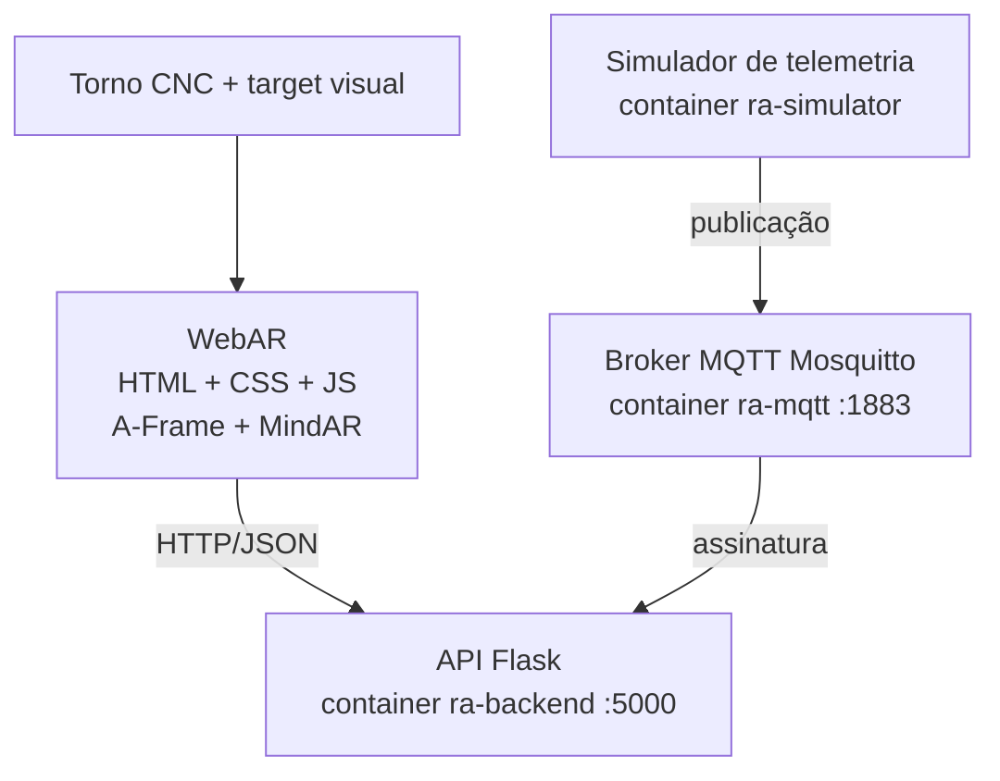

# Arquitetura

(Para a entrega, exporte este diagrama como `docs/arquitetura.png`, por exemplo em https://mermaid.live.)

## Responsabilidades
| Componente | Responsabilidade |
|-----------|------------------|
| WebAR | Reconhecer o target, exibir hotspots, mostrar informação e consultar a API |
| API Flask | Concentrar o acesso aos dados; guardar o último valor recebido por MQTT |
| Broker MQTT | Intermediar as mensagens de telemetria (publish/subscribe) |
| Simulador | Fazer o papel da máquina/gateway, publicando dados fictícios |
| Docker/Compose | Padronizar e coordenar a execução dos serviços |

## Fluxo
1. Simulador publica em `industria/CNC-01/temperatura` (e vibracao/status).
2. Broker entrega a mensagem ao assinante (API Flask).
3. API atualiza o último valor em memória.
4. Usuário toca no hotspot 5 -> `fetch()` -> API -> JSON -> painel RA.
